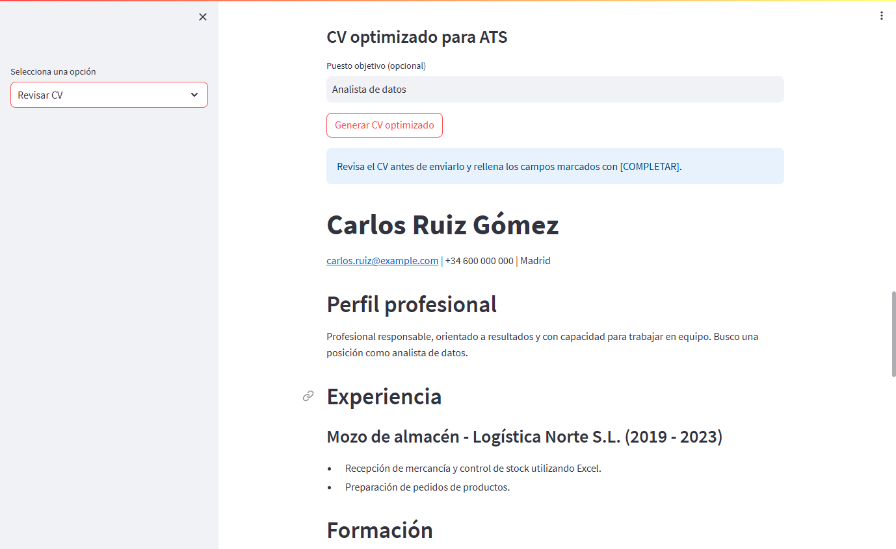
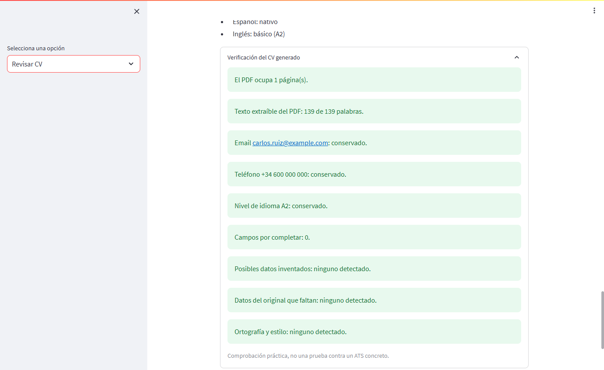
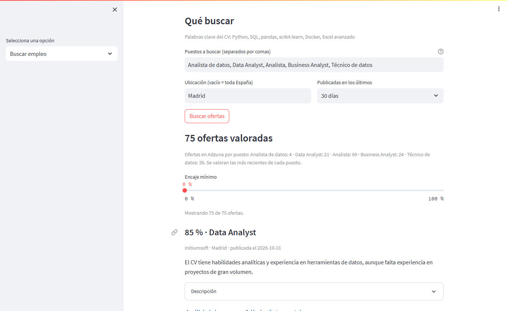
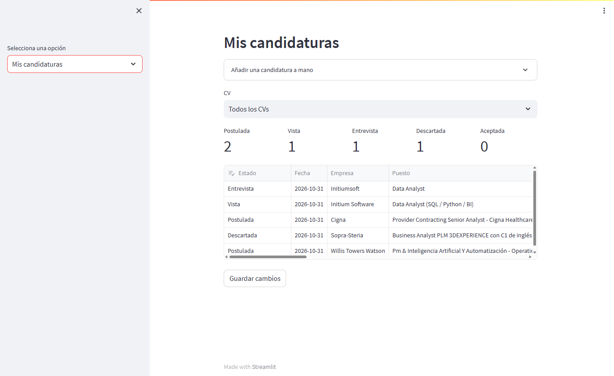
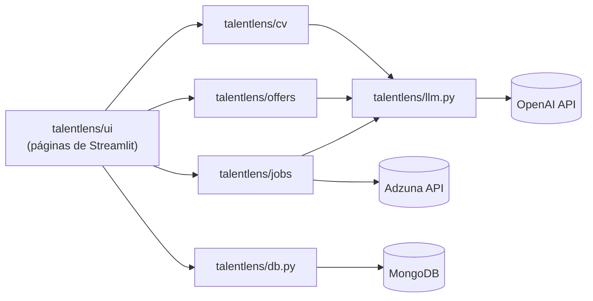

# TalentLens AI

[](https://github.com/freddyjmc/TalentLens-AI/actions/workflows/ci.yml)


Asistente de búsqueda de empleo con IA: optimiza tu CV para filtros ATS, busca ofertas reales que encajen con él, lleva el control de tus candidaturas y practica entrevistas, desde una sola aplicación web.

> Proyecto desarrollado durante el bootcamp de IA de F5 y ampliado después.



<table>
  <tr>
    <td></td>
    <td></td>
  </tr>
  <tr>
    <td align="center"><sub>Verificación automática del CV generado</sub></td>
    <td align="center"><sub>Ofertas reales de Adzuna puntuadas según el CV</sub></td>
  </tr>
</table>



<sub>Capturas con un CV ficticio.</sub>

## Qué hace

| Sección | Descripción |
|---|---|
| **Revisar CV** | Sube tu CV (texto, PDF o Word) y recibe una valoración sobre si pasaría filtros ATS, con sugerencias de mejora. |
| **CV optimizado para ATS** | Genera una versión de tu CV preparada para filtros ATS (opcionalmente para un puesto concreto) y descárgala en PDF, Word o TXT. No inventa datos: lo que falta queda marcado como `[COMPLETAR]`. Un verificador revisa el resultado antes de descargarlo. |
| **Buscar empleo** | A partir de tu CV, la IA propone los puestos a buscar, consulta ofertas reales en la API de Adzuna y puntúa de 0 a 100 cuánto encaja cada una, explicando por qué. Cada oferta enlaza primero a la web de la empresa y después al anuncio. |
| **Mis candidaturas** | Panel de seguimiento por CV: marca una oferta como postulada y sigue su estado (Postulada, Vista, Entrevista, Descartada, Aceptada) con notas. También puedes añadir candidaturas a mano. La inscripción siempre la haces tú. |
| **Analizar ofertas** | Pega un enlace o sube la oferta y obtén puesto, empresa, ubicación, habilidades requeridas, palabras clave y un resumen. |
| **Practicar entrevistas** | Indica un rol y genera preguntas habituales de entrevista. |
| **Asistente inteligente** | Chat con un asistente especializado en empleo, CVs y desarrollo profesional. |
| **Datos guardados** | Consulta las ofertas, revisiones de CV y CVs optimizados guardados en MongoDB y descárgalos en CSV. |

## Tecnologías

- **Python** y **Streamlit** para la interfaz web
- **OpenAI API** (`gpt-4o-mini`, configurable) para análisis, generación, verificación y chat
- **Adzuna API** para la búsqueda de ofertas reales
- **MongoDB** con **PyMongo** para el almacenamiento
- **Requests** y **lxml** para leer ofertas desde un enlace (con **Selenium** como respaldo)
- **pypdf**, **python-docx** y **fpdf2** para leer CVs y exportarlos a PDF y Word
- **pytest**, **mongomock** y **ruff** para tests y calidad de código
- **Docker** y **GitHub Actions** para el despliegue local y la integración continua

## Arquitectura



- **La interfaz no contiene lógica de negocio.** Las páginas de `talentlens/ui` solo muestran datos y llaman a los servicios, que son funciones puras o casi puras y se pueden probar sin Streamlit.
- **Un único punto de acceso a la IA** (`llm.py`): el modelo, los límites de tokens y el modo JSON se configuran en un solo sitio, y los tests lo sustituyen por una IA simulada.
- **Configuración sin efectos secundarios al importar**: `config.get_settings()` lee el entorno una vez y la conexión a MongoDB se crea cuando se necesita.

## Estructura del proyecto

```
TalentLens-AI/
├── app.py                      # Punto de entrada: menú y navegación
├── talentlens/
│   ├── config.py               # Configuración desde variables de entorno
│   ├── llm.py                  # Cliente único de OpenAI
│   ├── db.py                   # Acceso a MongoDB
│   ├── files.py                # Lectura de TXT, PDF y Word
│   ├── assistant.py            # Entrevistas y chat
│   ├── cv/
│   │   ├── review.py           # Revisión del CV
│   │   ├── generator.py        # CV optimizado para ATS
│   │   ├── verifier.py         # Verificación (reglas + segunda revisión con IA)
│   │   └── export.py           # Exportación a PDF, Word y TXT
│   ├── offers/
│   │   ├── scraper.py          # Lectura de ofertas desde un enlace
│   │   └── analysis.py         # Análisis de ofertas
│   ├── jobs/
│   │   ├── search.py           # Búsqueda en Adzuna y puntuación con IA
│   │   └── applications.py     # Candidaturas y estados
│   └── ui/                     # Una página de Streamlit por sección
├── tests/                      # Tests unitarios (sin red ni claves)
├── docs/img/                   # Capturas del README
├── Dockerfile
├── docker-compose.yml          # App + MongoDB
├── pyproject.toml              # Configuración de pytest, coverage y ruff
├── requirements.txt            # Dependencias de la app
├── requirements-dev.txt        # + herramientas de desarrollo
├── .env.example
└── LICENSE
```

## Instalación

### 1. Clonar y configurar

```bash
git clone https://github.com/freddyjmc/TalentLens-AI.git
cd TalentLens-AI
cp .env.example .env         # en Windows: copy .env.example .env
```

Rellena el `.env`:

| Variable | Para qué sirve |
|---|---|
| `OPENAI_API_KEY` | Clave de la API de OpenAI |
| `OPENAI_MODEL` | Opcional. Modelo de OpenAI (por defecto `gpt-4o-mini`) |
| `ADZUNA_APP_ID` / `ADZUNA_APP_KEY` | Credenciales gratuitas de [Adzuna](https://developer.adzuna.com/) para «Buscar empleo» |
| `MONGODB_URI` | Dirección de MongoDB (en local, `mongodb://localhost:27017/`) |
| `MONGODB_DB_NAME` | Nombre de la base de datos (por ejemplo, `asistente`) |

### 2a. Ejecutar con Docker (recomendado)

```bash
docker compose up -d --build
```

Abre <http://localhost:8501>. Para pararlo: `docker compose stop`.

### 2b. Ejecutar en local

```bash
python -m venv venv
venv\Scripts\activate        # Windows (en Linux / macOS: source venv/bin/activate)
pip install -r requirements.txt
docker compose up -d mongodb
streamlit run app.py
```

> **Lectura de ofertas por enlace:** funciona sin navegador, también en Docker. Solo las páginas que necesitan JavaScript usan Selenium, que requiere Google Chrome (en local). Si una web bloquea la lectura automática, la app lo indica y puedes subir el texto de la oferta como archivo.

## Tests y calidad

```bash
pip install -r requirements-dev.txt
pytest --cov          # tests unitarios con cobertura
ruff check .          # estilo y errores comunes
```

- **56 tests** que cubren el **96 %** de la lógica (`talentlens/` sin la interfaz).
- **Sin red ni claves**: OpenAI, Adzuna, las webs de empleo y MongoDB se sustituyen por dobles de prueba (`tests/conftest.py`). Si un test intentara una llamada real, fallaría.
- **Integración continua**: GitHub Actions ejecuta ruff y pytest en Python 3.9 y 3.11, y construye la imagen de Docker en cada push.

## Verificación del CV generado

Cada CV optimizado pasa dos controles antes de descargarlo:

1. **Reglas automáticas** (sin IA): el PDF ocupa una página, su texto se puede extraer, se conservan email, teléfono y niveles de idioma, y no quedan campos `[COMPLETAR]`.
2. **Segunda revisión con IA**: compara el CV original con el generado y señala datos inventados, datos perdidos y errores de ortografía.

Es una comprobación práctica, no una garantía frente a un ATS concreto.

## Seguridad

- Las claves solo se leen desde variables de entorno; `.env` está en `.gitignore` y `.dockerignore`.
- El contenedor de la app se ejecuta con un usuario sin privilegios.
- MongoDB no tiene contraseña en este entorno local, por eso `docker-compose.yml` solo lo expone en `127.0.0.1`. No lo uses tal cual en un servidor.
- La app no se salta protecciones anti-bot: si una web bloquea la lectura automática, se lo indica al usuario.

## Mejoras futuras

- Migrar al SDK actual de OpenAI y a una versión reciente de Streamlit.
- Tests de la interfaz con `streamlit.testing`.
- Despliegue online de la demo.

## Licencia

Distribuido bajo la licencia MIT. Consulta [LICENSE](LICENSE).

## Autor

**Freddy Materano**: [GitHub](https://github.com/freddyjmc)
